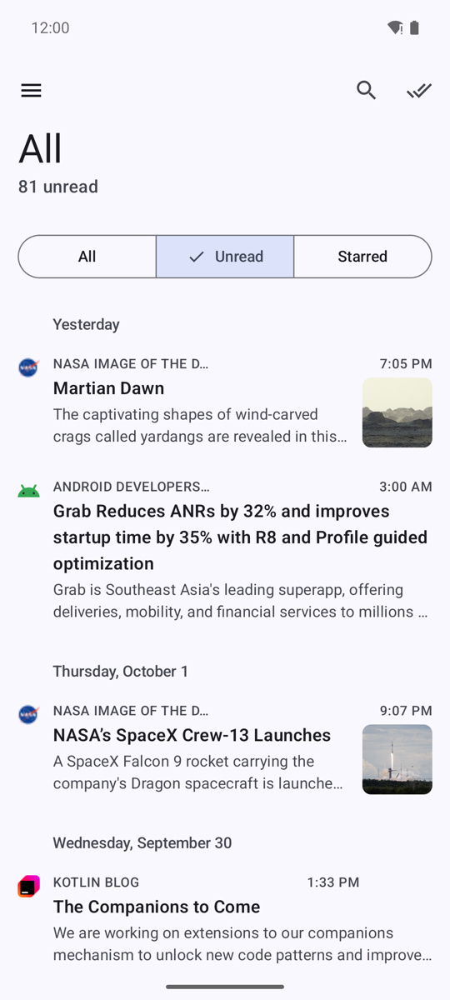
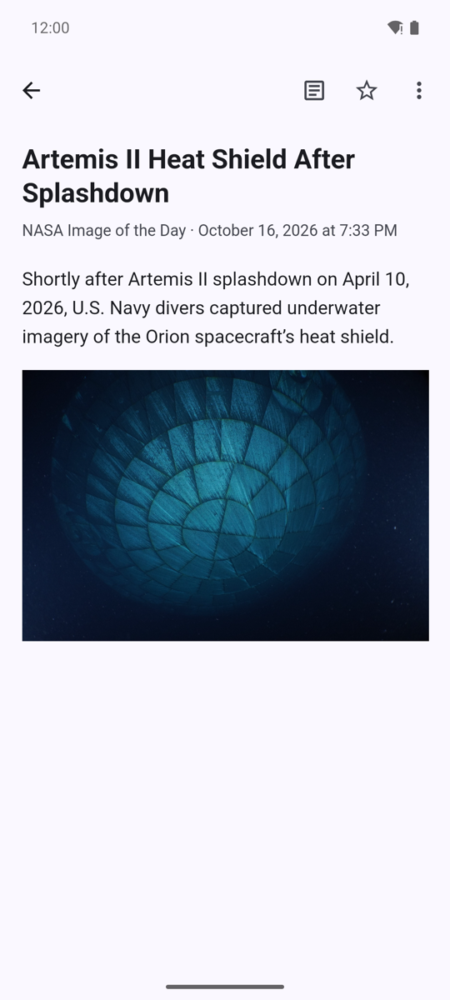
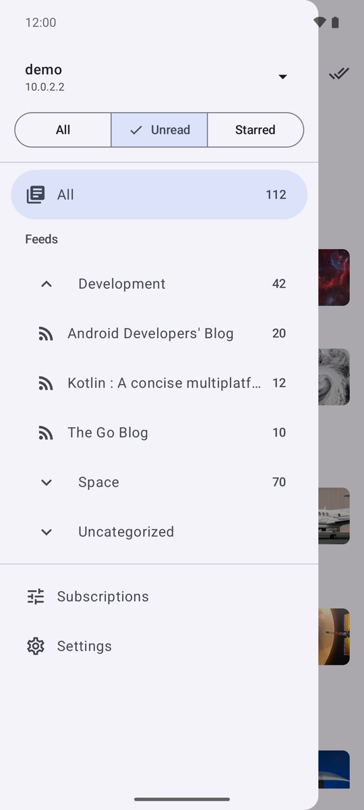
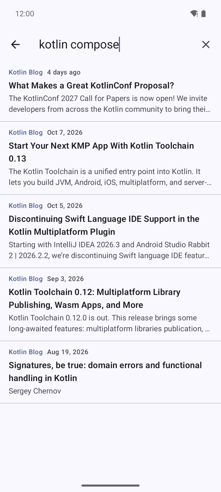
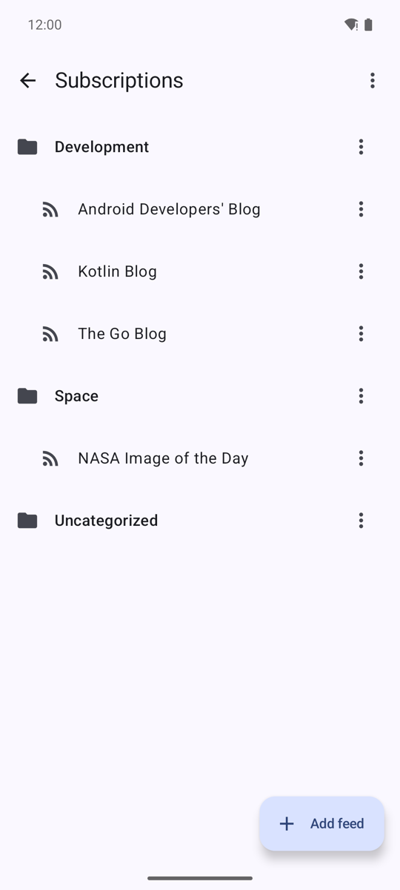
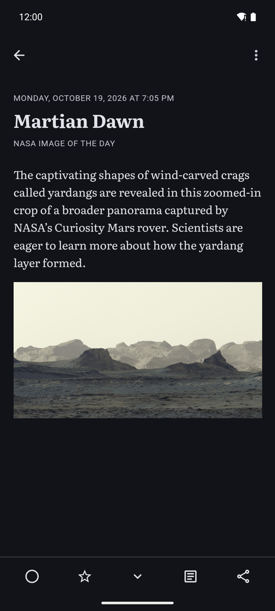
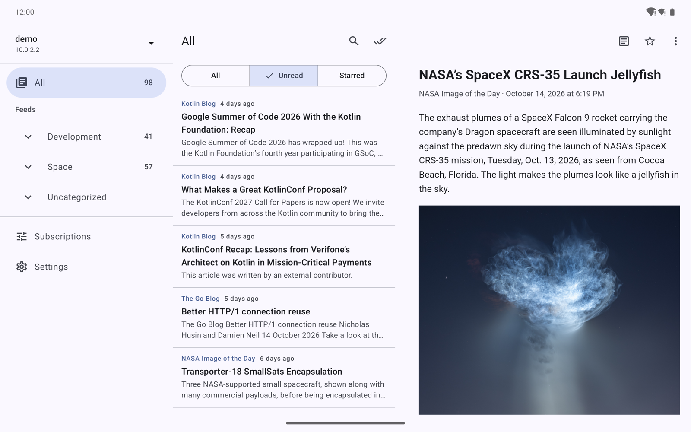

# Brook

An Android reader for [freshgo](https://github.com/juev/freshgo) and other servers that speak the Google Reader API. It is tested against freshgo only.

Brook keeps the subscriptions of your server on the phone and reads them without a network. Texts and pictures of unread and starred entries are downloaded ahead, changes made offline wait in a queue and go to the server when the network is back.

<p>
  
  
  
</p>

## Features

- Sign in with the server address, the user name and the API password. Several accounts, each with its own data; one is active at a time.
- All, unread and starred entries of everything, a category, a feed or a label. Unread counts in the tree.
- Offline reading. The pictures of unread and starred entries are downloaded on Wi-Fi (or on any network, in the settings). Read entries stay for 30 days by default, starred ones stay until unstarred.
- Read, star and label entries without a network; the server gets the changes at the next sync.
- New entries without a manual refresh: while the app is open it asks the server every minute and shows "N new" above the list without moving it. In the background it syncs every 15, 30 or 60 minutes, and can notify about new entries.
- Push from freshgo through [UnifiedPush](https://unifiedpush.org/): with a distributor such as ntfy, new entries and changes made on other devices reach Brook within seconds, even while it is closed. See [Push](#push).
- Full text: the reader extracts the article from the page of the entry on the device. A feed can be set to always show full text; its articles are then downloaded ahead with the pictures.
- Subscriptions: add a feed by address, rename it, move it to another category, unsubscribe; rename and delete categories and labels; import and export OPML.
- Search of the downloaded entries by title and text.
- Material 3 with dynamic color and a dark theme. On a tablet or an unfolded phone the list and the entry are side by side.

<p>
  
  
  
</p>



## Install

Brook needs Android 13 or later. Download the APK of the latest version from [Releases](https://github.com/juev/brook/releases) and open it on the phone.

The server address can be given with or without `/api/greader.php`. Use the API password from the settings of the server, not the password of its web interface. Release builds accept HTTPS only.

## Push

Push needs freshgo with VAPID keys (`freshgo vapid-keys`, then `-vapid-public-key`, `-vapid-private-key` and `-vapid-subject`) and a UnifiedPush distributor on the phone, such as [ntfy](https://ntfy.sh/). Turn on "Push from the server" in the settings of Brook. With several distributors installed, Brook asks which one to use.

Every account subscribes on its own. The settings show for each account whether push is on, whether its server does not push, or whether the user already has 10 browsers and apps subscribed on the server, the limit of freshgo. An account without push stays on the periodic sync, and the periodic sync keeps running as a fallback for all accounts.

After new entries arrive, freshgo pushes, Brook syncs and, if the setting is on, notifies. After entries are read, starred or changed elsewhere, freshgo pushes at most once per 30 seconds and Brook syncs without a notification. The device that made a change is told too: the token of the Reader API does not say which device made it.

freshgo refuses a distributor at a LAN or tailnet address, such as a self-hosted ntfy at home, unless `-fetch-allowlist` names that address. A distributor at a public address, such as ntfy.sh, needs nothing.

## Build

Requirements: JDK 21 and the Android SDK with platform 37.

```sh
export JAVA_HOME=/opt/homebrew/opt/openjdk@21   # or any JDK 21
./gradlew assembleDebug testDebugUnitTest lintDebug
./gradlew connectedDebugAndroidTest              # with an emulator or device attached
```

`local.properties` points Gradle at the SDK (`sdk.dir=...`); Android Studio writes it on its own.

Build types:

- `debug` allows plain HTTP to `10.0.2.2` and `localhost`, for a local server.
- `release` is shrunk by R8. It is signed when `BROOK_KEYSTORE`, `BROOK_KEYSTORE_PASSWORD`, `BROOK_KEY_ALIAS` and `BROOK_KEY_PASSWORD` are set, and unsigned otherwise. `-Pbrook.version=1.2.3` sets the version.
- `qa` is the release code signed with the debug key, with the plain HTTP of `debug`. It installs next to the others as `org.evsyukov.brook.qa`.

## Run against a local freshgo

`scripts/dev-freshgo.sh` starts a throwaway freshgo with the user `alice` (API password `brook-dev-pw`) and a local test feed on port 8080:

```sh
scripts/dev-freshgo.sh ../freshgo/bin/freshgo /tmp/brook-freshgo
scripts/dev-feed.py add /tmp/brook-freshgo/feed 3   # three new entries for the test feed
```

In Brook, sign in with the server `http://10.0.2.2:8080`. With that server running, `./gradlew testDebugUnitTest -Pbrook.live=http://127.0.0.1:8080` also runs the tests against it; they expect every entry of `alice` unread and not starred.

## Release

Pushing a tag `v1.2.3` runs the Release workflow: the tests, then the signed APK of version 1.2.3, published as a GitHub release with notes from the commits since the previous tag. The workflow can also be started by hand; it then keeps the APK as an artifact and publishes nothing.

The workflow takes the key from the repository secrets `BROOK_KEYSTORE_BASE64` (the keystore in Base64), `BROOK_KEYSTORE_PASSWORD`, `BROOK_KEY_ALIAS` and `BROOK_KEY_PASSWORD`.

## License

[AGPL-3.0](LICENSE), as freshgo.
